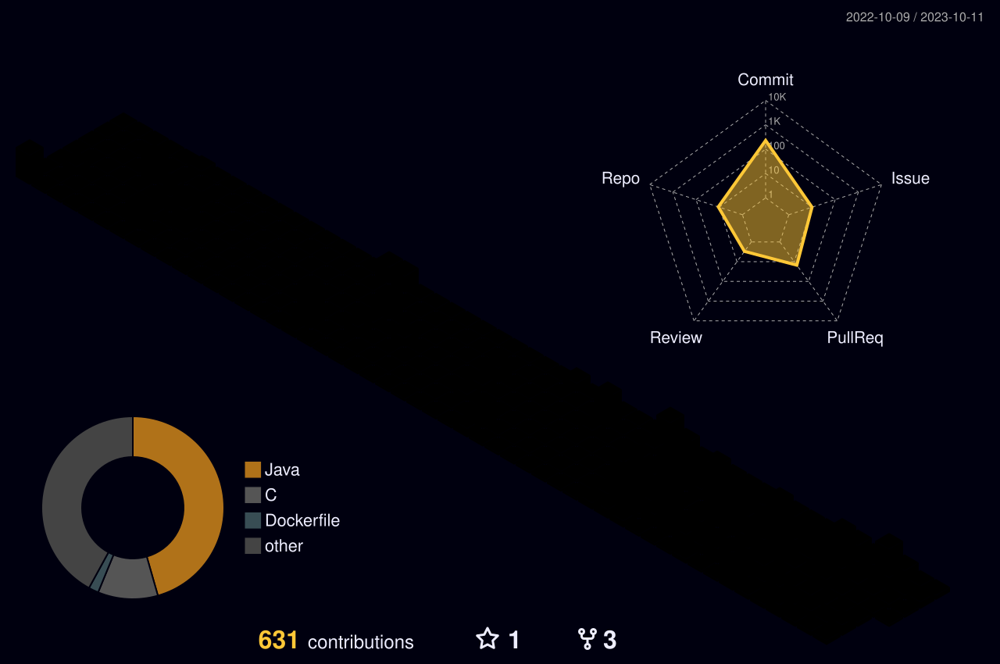

  

<!-- FCB6D0, fefeea -->

<h3 align="center">😋 Github Stats</h3>

    
   
  

 

<h3 align="center">😎 GitHub Contributions</h3>

  

 

<h3 align="center">🤗 Today I Learned</h3>

  
  

 

<!--
### Hi there 👋

- 🔭 I’m currently working on ...
- 🌱 I’m currently learning ...
- 👯 I’m looking to collaborate on ...
- 🤔 I’m looking for help with ...
- 💬 Ask me about ...
- 📫 How to reach me: ...
- 😄 Pronouns: ...
- ⚡ Fun fact: ...
-->

